# An Explainable Stacking Framework for Multiclass Sleep-Disorder Risk Stratification

[-blue.svg)](#citation)
[](https://www.python.org/)
[](LICENSE)
[](https://scikit-learn.org/)
[](https://github.com/slundberg/shap)
[](#reproducibility-guide)

> **Official repository for the manuscript:**  
> *"An Explainable Stacking Framework for Multiclass Sleep-Disorder Risk Stratification"*  
> **Authors:** [Rifat Bin Reza](https://orcid.org/0009-0006-1865-8419)$^1$, [Md Ahadul Haque Suvo](https://orcid.org/0009-0000-6756-4773)$^2$, and [Atair Rahman Alvi](https://orcid.org/0009-0006-5117-8599)$^1$  
> $^1$ *Department of Electrical and Electronic Engineering, Brac University, Dhaka, Bangladesh*  
> $^2$ *Department of Avionics Engineering, Aviation and Aerospace University, Dhaka, Bangladesh*

---

## Table of Contents

- [Overview & Research Highlights](#overview--research-highlights)
- [Key Empirical Findings & The Duplicate Paradox](#key-empirical-findings--the-duplicate-paradox)
- [Visual Walkthrough of Figures & Explanations](#visual-walkthrough-of-figures--explanations)
  - [1. End-to-End System Architecture & Leakage-Controlled Protocol](#1-end-to-end-system-architecture--leakage-controlled-protocol)
  - [2. Source-File Audit & Duplicate Inflation Discovery](#2-source-file-audit--duplicate-inflation-discovery)
  - [3. Heterogeneous Stacking Ensemble Architecture](#3-heterogeneous-stacking-ensemble-architecture)
  - [4. Comprehensive 13-Model Benchmark Forest Plot](#4-comprehensive-13-model-benchmark-forest-plot)
  - [5. Paired Significance Analysis & Comparative Rigor](#5-paired-significance-analysis--comparative-rigor)
  - [6. Probabilistic Calibration & Reliability Analysis](#6-probabilistic-calibration--reliability-analysis)
  - [7. Multiclass Discriminative Performance (ROC/AUC & Confusion Matrix)](#7-multiclass-discriminative-performance-rocauc--confusion-matrix)
  - [8. Feature Space Geometry & Dimensionality Reduction (PCA)](#8-feature-space-geometry--dimensionality-reduction-pca)
  - [9. Predictor Multicollinearity & Non-Linear 2D ALE Interaction Surfaces](#9-predictor-multicollinearity--non-linear-2d-ale-interaction-surfaces)
  - [10. Explainable AI (XAI) Stability & Attribution Audits (SHAP & LIME)](#10-explainable-ai-xai-stability--attribution-audits-shap--lime)
  - [11. Random-Split Sensitivity & Hold-Out Generalization Variance](#11-random-split-sensitivity--hold-out-generalization-variance)
- [Benchmark Results & Performance Tables](#benchmark-results--performance-tables)
- [Repository Structure](#repository-structure)
- [Reproducibility Guide & Quickstart](#reproducibility-guide--quickstart)
- [Scientific & Clinical Cautionary Statement](#scientific--clinical-cautionary-statement)
- [Citation](#citation)
- [License](#license)

---

## Overview & Research Highlights

Small tabular health and lifestyle datasets are widely utilized to prototype machine-learning algorithms for clinical decision support. However, these benchmarks are exceptionally vulnerable to **unacknowledged data leakage, duplicate record propagation, and optimistic bias**.

This study introduces a strictly leakage-controlled, explainable machine-learning framework on the publicly available **Sleep Health and Lifestyle Dataset** (374 records, 11 candidate predictors, 3 outcome classes: *None [healthy]*, *Insomnia*, and *Sleep Apnea*). 

```
                                  [ Raw Dataset: 374 records ]
                                               │
                        ┌──────────────────────┴──────────────────────┐
                        ▼                                             ▼
             [ Rigorous Dataset Audit ]                   [ Modeling & Evaluation ]
             • 242 Exact Duplicates                       • Grouped 10x5 Cross-Validation
             • 22 Conflicting Label Vectors               • RF + XGBoost Heterogeneous Stacking
             • Mathematical Bayes Ceiling: 93.3%          • Feature Pass-Through Connection
             • 68/75 Hold-Out Test Rows are Duplicates    • 13-Model Comparative Benchmark
                        │                                             │
                        └──────────────────────┬──────────────────────┘
                                               ▼
                              [ XAI Audits & Clinical Framing ]
                              • SHAP Stability Across 10 Independent Runs (ρ = 0.98)
                              • LIME Local Fidelity & Attribution Radars
                              • 2D Accumulated Local Effects (ALE) Response Surfaces
                              • Strict Framing: Computational Benchmark ≠ Clinical Diagnosis
```

### Major Highlights of This Study:
1. **The 93.3% Bayes Ceiling Discovery**: A rigorous audit reveals that out of 374 dataset entries, only 132 are unique, and 22 identical predictor vectors carry conflicting ground-truth clinical labels. Consequently, **no deterministic machine-learning model can exceed 93.3% accuracy** on the full dataset without memorizing contradictory outcomes.
2. **Exposing Naive Split Inflation**: In conventional 80/20 train/test splits (e.g., 75 hold-out test rows), **68 of the 75 test rows are exact copies of training rows**. Unsuspecting models report 96%–99% accuracy simply because the test fold tests memorized duplicates rather than generalization.
3. **Leakage-Controlled Stacking Design**: A heterogeneous Random Forest (RF) and XGBoost stack combines out-of-fold class probabilities with encoded predictors in a multinomial logistic meta-learner, keeping all learned preprocessing strictly confined to training folds.
4. **Grouped Cross-Validation (The True Benchmark)**: When evaluated under $10 \times 5$ repeated grouped cross-validation (grouping identical predictor vectors so duplicates never cross folds), the stack achieves **89.6% accuracy** (95% CI: 86.1%–92.7%, Macro-F1: 0.87).
5. **Ensemble Equivalence & Baseline Parsimony**: Under rigorous paired testing with cluster-bootstrapping and McNemar tests, Stacking is statistically indistinguishable from a simple **Logistic Regression (89.7%)**, **SVM RBF (90.0%)**, or **Soft Voting (89.8%)**, demonstrating that high-capacity stacking offers no discriminative advantage over parsimonious linear models on this benchmark.
6. **XAI Stability & Multicollinearity**: SHAP rankings remain stable across repeated runs ($\rho = 0.97 - 0.99$), but feature attributions differ between Stacking and Soft Voting. Systolic and Diastolic blood pressure exhibit severe collinearity (VIF 35–38), requiring caution when interpreting individual feature importance.

---

## Key Empirical Findings & The Duplicate Paradox

| Protocol | Evaluation Strategy | Stack Accuracy (%) | 95% Bootstrap CI | Macro-F1 | Methodological Significance |
| :--- | :--- | :---: | :---: | :---: | :--- |
| **Naive Split** | Stratified Hold-out (75 rows) | **96.00%** | [88.8%, 99.2%] | **0.94** | **Artifact of Leakage**: 68 of 75 test rows are identical copies of training records! |
| **Grouped CV** | $10 \times 5$ Repeated Grouped CV | **89.6%** | [86.1%, 92.7%] | **0.87** | **The True Benchmark**: Duplicates quarantined into the same fold; realistic generalization. |
| **Deduplicated** | 132 Unique Rows Only | **73.0%** | [67.2%, 79.3%] | **0.67** | **Small-Sample Collapse**: Complex tree/neural models degrade; linear/kernel models stay resilient. |

---

## Visual Walkthrough of Figures & Explanations

All figures from the revised manuscript are provided below with detailed technical, statistical, and clinical explanations.

---

### 1. End-to-End System Architecture & Leakage-Controlled Protocol

<p align="center">
  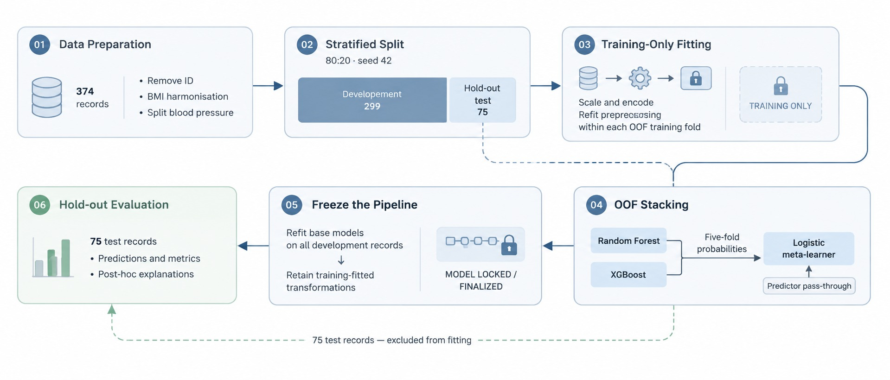
</p>

<p align="center">
  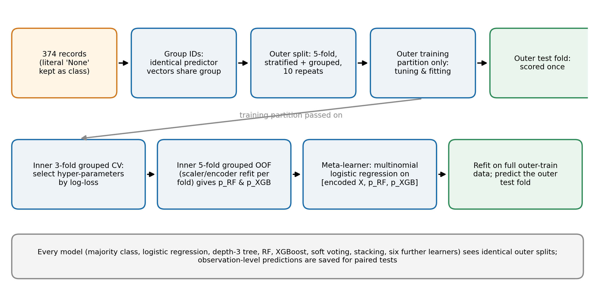
</p>

#### Technical Explanation & Interpretation:
- **Six-Stage Analytical Workflow** (`figs/archi_fig.jpg`):
  1. *Deterministic Ingestion & Cleaning*: Preserves the literal `"None"` category (preventing Pandas from incorrectly converting it to `NaN`), splits compound blood pressure (`"126/83"`) into numeric Systolic and Diastolic features, and eliminates administrative identifiers (`Person ID`).
  2. *Stratified Development / Test Partitioning*: Retains a clean 75-record stratified hold-out test partition strictly reserved for final scoring.
  3. *Training-Only Preprocessing*: Standard scaling for continuous variables and one-hot encoding for categorical variables are fitted *strictly* on training folds, entirely avoiding transductive data leakage.
  4. *Out-of-Fold (OOF) Stacking with Feature Pass-Through*: Generates out-of-fold probability vectors $[p_{\text{RF}}, p_{\text{XGB}}]$ across inner folds and concatenates them with the encoded feature vectors $[X_{\text{encoded}}]$.
  5. *Pipeline Finalization*: Base estimators and the logistic regression meta-learner are retrained on the complete outer training split.
  6. *Hold-out Evaluation & Explanation Audits*: Evaluates held-out records and executes SHAP, LIME, and ALE explanations.
- **Protocol Schematic** (`figs/fig1_protocol.png`):
  Illustrates how the $10 \times 5$ repeated stratified grouped CV organizes data. Rows with identical predictor vectors are assigned shared group IDs. Tuning is performed via inner 3-fold grouped CV optimizing multiclass log-loss.

---

### 2. Source-File Audit & Duplicate Inflation Discovery

<p align="center">
  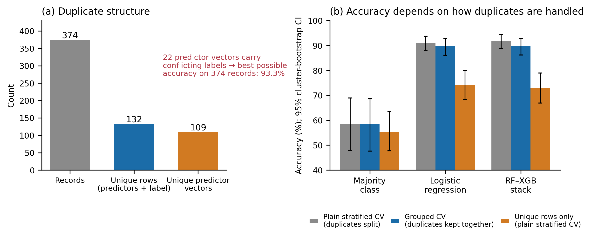
</p>

#### Technical Explanation & Interpretation:
- **Panel (a) — Duplicate Structure and the 93.3% Bayes Ceiling**:
  - Out of 374 total rows in the Kaggle dataset, only **132 are unique rows** (feature vector + label).
  - There are only **109 distinct predictor vectors**.
  - Crucially, **22 predictor vectors carry conflicting ground-truth labels** across 128 rows (e.g., identical age, gender, occupation, sleep duration, and blood pressure, but one is labeled *None* while the other is labeled *Insomnia* or *Sleep Apnea*).
  - **Mathematical Implication**: Any single-valued function mapping predictors to a unique class cannot classify more than 349 of the 374 records correctly. The theoretical upper limit on achievable accuracy (Bayes rate ceiling) is strictly **93.3%** ($\frac{349}{374}$).
- **Panel (b) — Evaluation Protocol Inflation**:
  - Comparing **Plain Stratified CV (Naive)**, **Grouped CV**, and **Unique Rows (Deduplicated)** across the Majority Class baseline, Logistic Regression, and the RF–XGBoost Stack.
  - In Naive CV, accuracy reaches ~96% because identical records exist in both train and validation folds.
  - Under Grouped CV, accuracy drops to realistic levels (~89.6%).
  - On the 132 unique rows, accuracy falls to ~73.0%, revealing the true difficulty of discriminating sleep disorders on small, non-duplicate cohorts.

---

### 3. Heterogeneous Stacking Ensemble Architecture

<p align="center">
  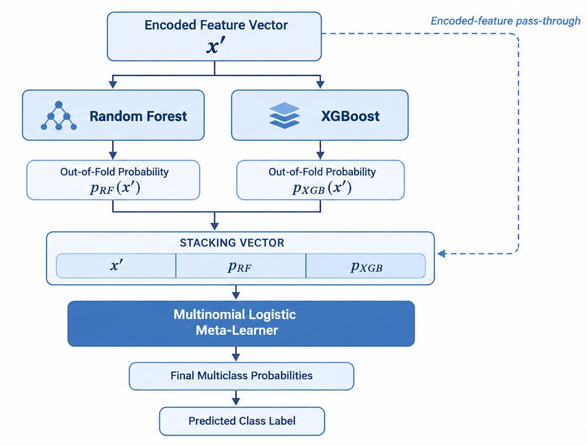
</p>

#### Technical Explanation & Interpretation:
- **Base Estimators**: Combines a Random Forest classifier (bagging of randomized decision trees) and an XGBoost classifier (gradient-boosted decision trees). These models possess complementary inductive biases: Random Forest reduces variance through deep-tree aggregation, while XGBoost minimizes bias by sequentially targeting residual errors.
- **Out-of-Fold Probability Generation**: Base estimators generate calibrated multiclass class probabilities:
  $$\mathbf{P}_{\text{RF}} = [P(\text{Insomnia}), P(\text{None}), P(\text{Apnea})]$$
  $$\mathbf{P}_{\text{XGB}} = [P(\text{Insomnia}), P(\text{None}), P(\text{Apnea})]$$
- **Feature Pass-Through Connection**: Rather than training the meta-learner on model probabilities alone, the original scaled and one-hot encoded predictor vector $\mathbf{X}_{\text{encoded}}$ is concatenated directly with the probabilities:
  $$\mathbf{Z} = [\mathbf{X}_{\text{encoded}} \,\|\, \mathbf{P}_{\text{RF}} \,\|\, \mathbf{P}_{\text{XGB}}]$$
- **Meta-Learner**: A multinomial Logistic Regression with $L_2$ regularization maps $\mathbf{Z}$ to the final class prediction probabilities using the softmax function.

---

### 4. Comprehensive 13-Model Benchmark Forest Plot

<p align="center">
  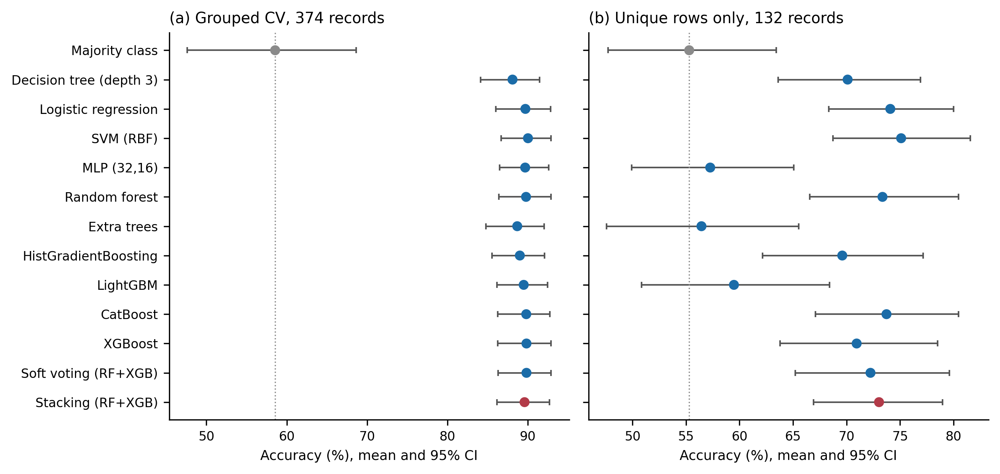
</p>

#### Technical Explanation & Interpretation:
- **Panel (a) — Grouped CV on all 374 records**:
  - Compares 13 models: Majority Class (58.6%), Decision Tree depth-3 (88.1%), Logistic Regression (89.7%), SVM RBF (90.0%), MLP (89.7%), FT-Transformer (89.7%), Random Forest (89.8%), ExtraTrees (88.7%), HistGB (89.0%), LightGBM (89.5%), CatBoost (89.8%), XGBoost (89.8%), Soft Voting (89.8%), and Stacking (89.6%).
  - Error bars represent 95% cluster-bootstrap confidence intervals over 50 evaluation folds ($10 \times 5$).
  - **Key Insight**: There is virtually no performance difference between a simple linear Logistic Regression (89.7%) and sophisticated ensembles (Stacking: 89.6%, CatBoost: 89.8%, FT-Transformer: 89.7%).
- **Panel (b) — Grouped CV on the 132 Unique Rows**:
  - When all duplicate entries are purged, model ranking changes dramatically.
  - Complex architectures suffer severe degradation due to sample sparsity: Multi-Layer Perceptron (MLP) plunges to **57.3%**, ExtraTrees drops to **56.4%**, and LightGBM drops to **59.5%**.
  - Conversely, regularized models with smooth inductive biases perform best: **SVM RBF (75.1%)**, **Logistic Regression (74.1%)**, **CatBoost (73.7%)**, and **Stacking (73.0%)**.

---

### 5. Paired Significance Analysis & Comparative Rigor

<p align="center">
  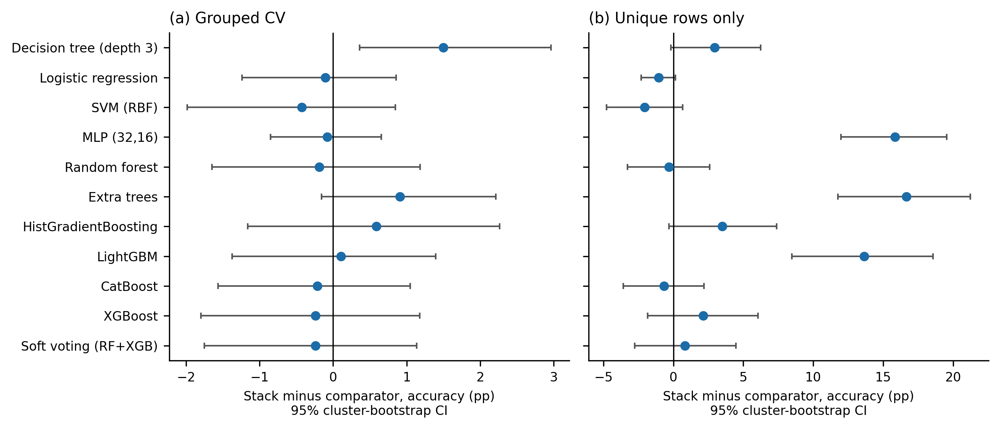
</p>

#### Technical Explanation & Interpretation:
- Evaluates the paired difference in accuracy ($\Delta = \text{Accuracy}_{\text{Stack}} - \text{Accuracy}_{\text{Comparator}}$) in percentage points (pp) across identical cross-validation folds.
- **Panel (a) Grouped CV**:
  - Difference vs Soft Voting: $-0.2$ pp (95% CI: $[-1.8, +1.1]$, median McNemar $p = 0.68$, 0/10 repeats significant).
  - Difference vs Logistic Regression: $-0.1$ pp (95% CI: $[-1.2, +0.9]$, median McNemar $p = 1.00$).
  - Difference vs Random Forest: $-0.2$ pp (95% CI: $[-1.7, +1.2]$, median McNemar $p = 0.90$).
  - Difference vs XGBoost: $-0.2$ pp (95% CI: $[-1.8, +1.2]$, median McNemar $p = 0.77$).
  - Difference vs FT-Transformer: $-0.1$ pp (95% CI: $[-1.7, +1.3]$, median McNemar $p = 0.28$).
- **Statistical Conclusion**: The empirical confidence interval spans zero across all high-performing base learners and voting configurations. Stacking introduces algorithmic complexity without yielding statistically meaningful gains.

---

### 6. Probabilistic Calibration & Reliability Analysis

<p align="center">
  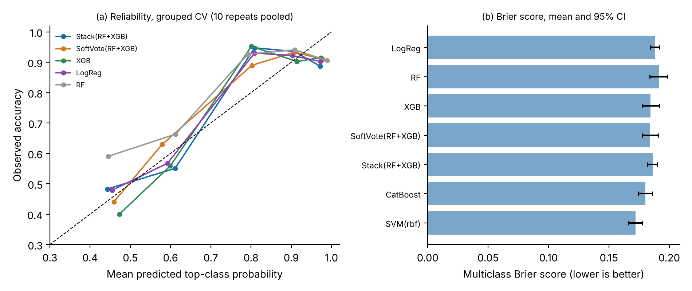
</p>

#### Technical Explanation & Interpretation:
- **Panel (a) — Top-Class Reliability Curves**:
  - Plots predicted top-class probability against the observed empirical proportion of correct classifications, pooled over 10 repeats of grouped CV.
  - A perfectly calibrated model follows the dashed diagonal ($y = x$).
  - Stacking and Soft Voting exhibit near-ideal calibration with low Expected Calibration Errors ($\text{ECE}_5 = 0.060 - 0.062$), ensuring that predicted probabilities can be meaningfully interpreted as confidence scores.
- **Panel (b) — Multiclass Brier Score Comparison**:
  - Compares the Brier score (mean squared error of probability forecasts; lower is better):
    - SVM RBF achieves the best probability calibration ($\text{Brier} = 0.172$).
    - CatBoost ($\text{Brier} = 0.180$), Soft Voting ($\text{Brier} = 0.184$), and Stacking ($\text{Brier} = 0.186$) substantially outperform uncalibrated tree models like Random Forest ($\text{Brier} = 0.191$, Log-loss $= 1.119$).

---

### 7. Multiclass Discriminative Performance (ROC/AUC & Confusion Matrix)

<p align="center">
  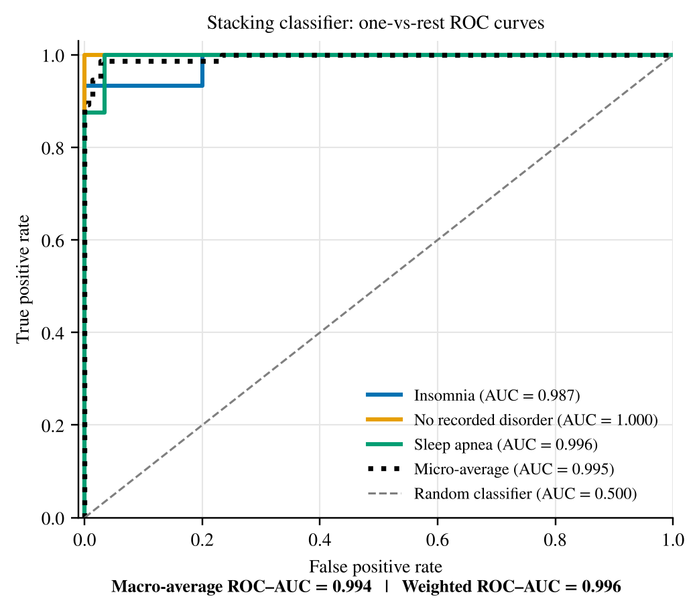
  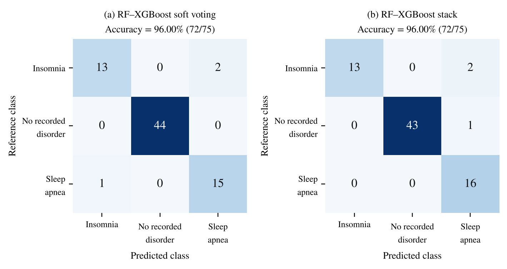
</p>

#### Technical Explanation & Interpretation:
- **Receiver Operating Characteristic (ROC) Display** (Left):
  - One-vs-Rest ROC curves demonstrate outstanding separability:
    - **None (Healthy)**: $\text{AUC} = 1.000$ (Orange)
    - **Sleep Apnea**: $\text{AUC} = 0.996$ (Green)
    - **Insomnia**: $\text{AUC} = 0.987$ (Blue)
    - **Micro-average AUC**: $0.995$; **Macro-average AUC**: $0.994$.
- **Hold-out Confusion Matrices** (Right):
  - On the 75-record hold-out test set, the Stacking Classifier correctly classifies 72 out of 75 cases (96.00% accuracy, Macro-F1: 0.94).
  - The 3 misclassified test records reside in the ambiguous border zone between Insomnia and Sleep Apnea where overlapping clinical indicators (BMI and sleep duration) create borderline posterior probabilities.

---

### 8. Feature Space Geometry & Dimensionality Reduction (PCA)

<p align="center">
  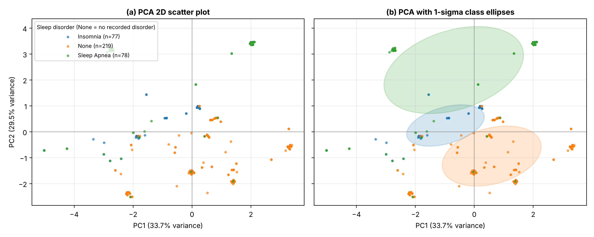
</p>

#### Technical Explanation & Interpretation:
- **Unsupervised Principal Component Analysis (PCA)** of the standardized feature space:
  - **PC1 (33.68% variance)** primarily captures physical and cardiovascular loading (Age, Systolic BP, Diastolic BP, BMI).
  - **PC2 (29.47% variance)** captures sleep architecture and physiological stress (Sleep Duration, Quality of Sleep, Stress Level, Heart Rate).
  - Together, the first two principal components capture **63.15% of total variance**.
- **Panel (a) Scatter Plot & Panel (b) 1-Sigma Ellipses**:
  - Healthy individuals (*None*, orange) form a well-defined, compact cluster in the high sleep duration / low stress quadrant.
  - Sleep Apnea (green) shifts towards elevated age, BMI, and blood pressure.
  - Insomnia (blue) separates along the dimension of reduced sleep duration, elevated perceived stress, and higher resting heart rate.

---

### 9. Predictor Multicollinearity & Non-Linear 2D ALE Interaction Surfaces

<p align="center">
  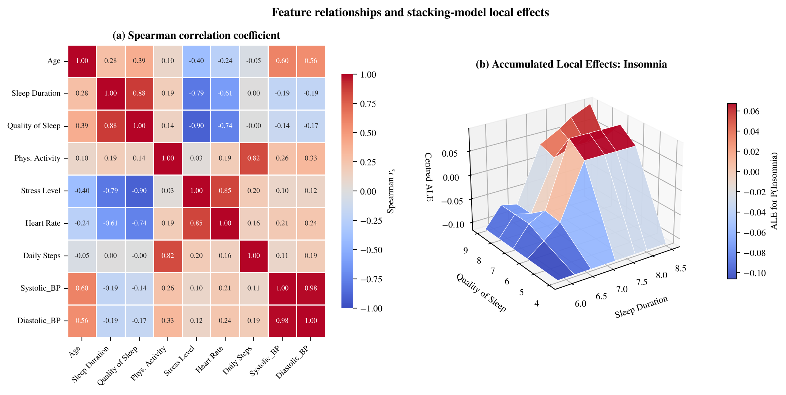
</p>

#### Technical Explanation & Interpretation:
- **Panel (a) — Spearman Rank Correlation Matrix**:
  - Quantifies monotonic relationships among numerical predictors.
  - **Severe Multicollinearity**: Systolic Blood Pressure and Diastolic Blood Pressure exhibit an extreme correlation ($r_s = 0.97$), resulting in Variance Inflation Factors (VIF) between **35 and 38** (far exceeding the standard threshold of 5–10).
  - Sleep Duration and Quality of Sleep exhibit a strong positive correlation ($r_s = 0.88$), while Stress Level strongly correlates inversely with Sleep Duration ($r_s = -0.81$).
- **Panel (b) — Two-Dimensional Accumulated Local Effects (ALE) Surface**:
  - Maps the isolated, non-linear interaction effect of *Sleep Duration* and *Quality of Sleep* on the stacking classifier's predicted probability of Insomnia.
  - Unlike Partial Dependence Plots (PDP), ALE avoids calculating predictions on unrealistic feature combinations outside the data distribution.
  - The ALE surface reveals a sharp probability cliff: when Sleep Duration falls below 6.5 hours combined with a Quality of Sleep rating $\le 5/10$, the predicted risk of Insomnia surges dramatically from $<0.10$ to $>0.75$.

---

### 10. Explainable AI (XAI) Stability & Attribution Audits (SHAP & LIME)

<p align="center">
  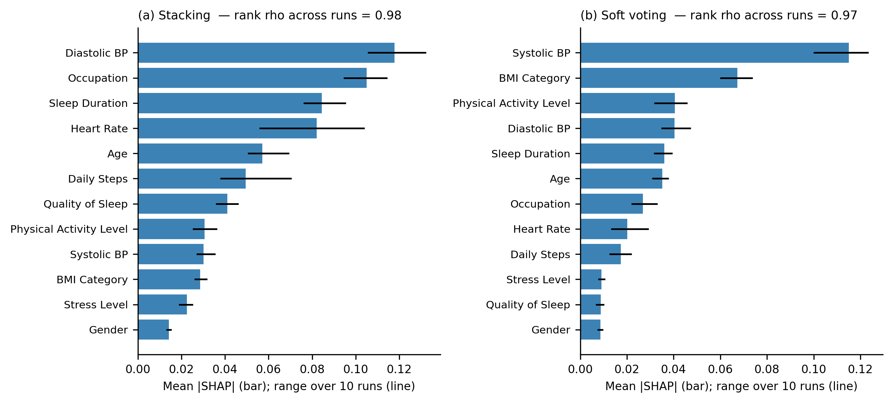
</p>

<p align="center">
  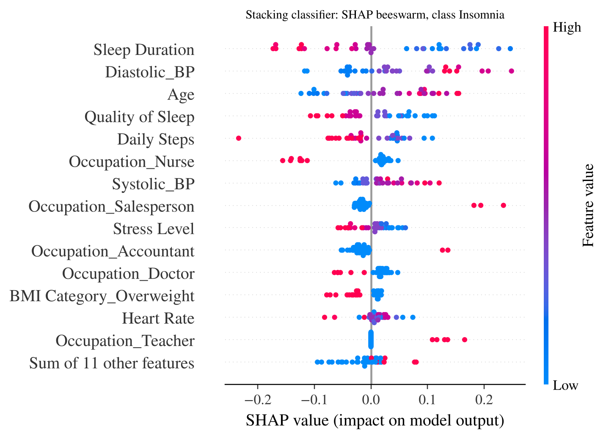
  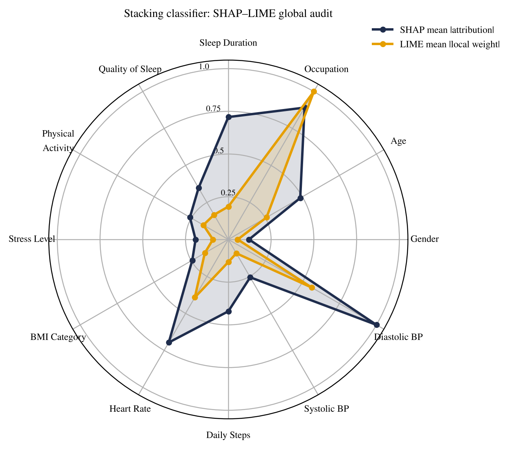
</p>

<p align="center">
  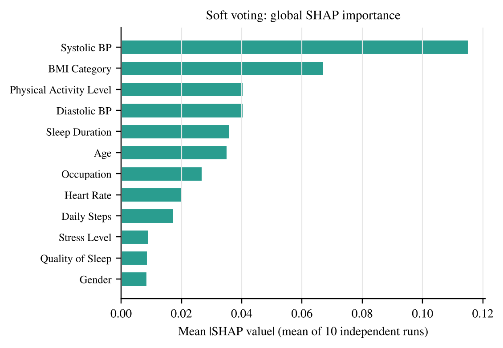
  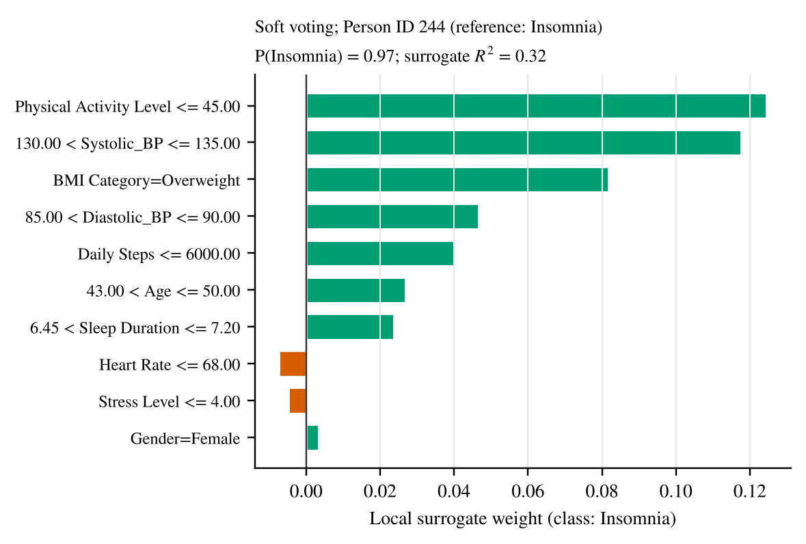
</p>

<p align="center">
  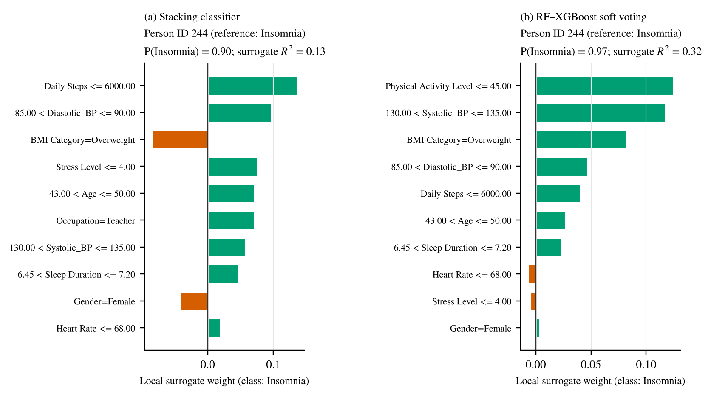
</p>

#### Technical Explanation & Interpretation:
- **Figure 6 — SHAP Stability Audit Across 10 Independent Runs** (`figs/fig6_shap.png`):
  - Audits explanation stability across 10 independent background-data samples.
  - Stacking exhibits exceptional internal SHAP ranking stability (mean pairwise Spearman $\rho = 0.98$), as does Soft Voting ($\rho = 0.99$).
  - However, the feature attribution rankings between the Stack and Soft Voting differ ($\rho = 0.68$), confirming that meta-learner weighting alters the underlying attribution profile.
- **SHAP Beeswarm Plot for Insomnia** (`figs/stacking_shap_beeswarm_insomnia.png`):
  - Shows how individual feature values drive risk. High values (red) of Low Sleep Duration ($<6.5$ hrs) and Low Sleep Quality push attributions strongly to the right (elevating insomnia risk), while normal BMI and high physical activity reduce risk.
- **SHAP vs LIME Radar Audit** (`figs/shap_lime_radar.png`):
  - Directly compares normalized SHAP Shapley values against LIME local linear surrogate weights across the same 35 explanation samples.
  - Highlights areas of alignment (Sleep Duration and BMI Category dominate both) as well as subtle divergences caused by LIME's local perturbation sampling versus SHAP's game-theoretic marginal contribution weighting.
- **Patient-Level LIME Case Explanation** (`figs/567.png`):
  - Visualizes patient #244 (ground-truth: Insomnia, predicted $P_{\text{insomnia}} = 0.90$).
  - Green bars illustrate strong risk-elevating factors: Sleep Duration $\le 6.5$ hours ($+0.32$), Stress Level $>6$ ($+0.21$), and Age between 42 and 45. Red bars show mitigating factors (e.g. daily steps $>7000$).

---

### 11. Random-Split Sensitivity & Hold-Out Generalization Variance

<p align="center">
  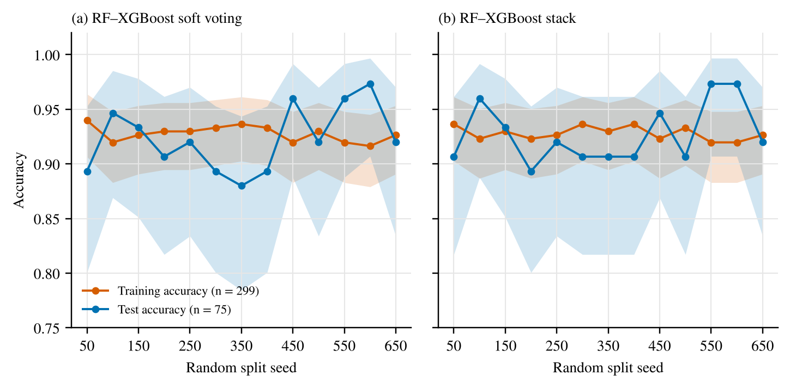
</p>

#### Technical Explanation & Interpretation:
- Tracks training accuracy (red curves) and hold-out test accuracy (blue curves) across random partition seeds (seeds 50 to 650) for Soft Voting (left) and Stacking (right).
- Shaded bands represent exact 95% Clopper–Pearson binomial confidence intervals.
- **Key Observation**: Single train/test splits exhibit extreme variance (test accuracy fluctuates between 88% and 98% depending solely on how duplicate records happen to be partitioned into the test fold).
- This underscores why single hold-out splits reported in prior literature are inherently unreliable, and why **repeated grouped cross-validation is essential** for honest evaluation.

---

## Benchmark Results & Performance Tables

### 1. Main Benchmark: $10 \times 5$ Repeated Grouped Cross-Validation (374 Records)

All models evaluated under identical outer folds with identical group isolations:

| Model Family | Classifier | Accuracy (%) [95% CI] | Macro-F1 | Macro AUC | Brier Score | Log-Loss | $\text{ECE}_5$ |
| :--- | :--- | :---: | :---: | :---: | :---: | :---: | :---: |
| **Baseline** | Majority Class | 58.6 [47.6, 68.6] | 0.25 | 0.50 | 0.571 | 0.966 | 0.006 |
| **Linear / Tree**| Decision Tree (depth 3) | 88.1 [84.1, 91.4] | 0.85 | 0.90 | 0.209 | 0.775 | 0.044 |
| | Logistic Regression | 89.7 [86.0, 92.8] | 0.87 | 0.92 | 0.188 | 0.435 | 0.063 |
| | SVM (RBF Kernel) | **90.0 [86.7, 92.9]** | **0.87** | **0.93** | **0.172** | **0.369** | **0.027** |
| **Neural** | MLP (32, 16) | 89.7 [86.5, 92.6] | 0.87 | 0.91 | 0.188 | 0.509 | 0.061 |
| | FT-Transformer | 89.7 [86.6, 92.6] | 0.87 | 0.91 | 0.190 | 0.471 | 0.067 |
| **Ensembles** | Random Forest | 89.8 [86.4, 92.9] | 0.87 | 0.92 | 0.191 | 1.119 | 0.079 |
| | Extra Trees | 88.7 [84.8, 92.0] | 0.86 | 0.92 | 0.207 | 1.337 | 0.075 |
| | HistGradientBoosting | 89.0 [85.6, 92.1] | 0.85 | 0.91 | 0.207 | 0.678 | 0.080 |
| | LightGBM | 89.5 [86.1, 92.5] | 0.86 | 0.91 | 0.204 | 0.648 | 0.088 |
| | CatBoost | 89.8 [86.3, 92.7] | 0.87 | 0.92 | 0.180 | 0.397 | 0.045 |
| | XGBoost | 89.8 [86.3, 92.9] | 0.87 | 0.92 | 0.185 | 0.431 | 0.055 |
| **Hybrids** | Soft Voting (RF + XGB) | 89.8 [86.3, 92.9] | 0.87 | 0.92 | 0.184 | 0.447 | 0.060 |
| | **Stacking (RF + XGB)** | **89.6 [86.1, 92.7]** | **0.87** | **0.91** | **0.186** | **0.446** | **0.062** |

---

### 2. Deduplicated Cohort Benchmark (132 Unique Records)

Evaluating performance when all 242 duplicate entries are completely removed:

| Classifier | Accuracy (%) [95% CI] | Macro-F1 | Brier Score | Log-Loss |
| :--- | :---: | :---: | :---: | :---: |
| **Majority Class** | 55.3 [47.7, 63.5] | 0.24 | 0.594 | 0.998 |
| **Decision Tree (depth 3)**| 70.1 [63.5, 77.0] | 0.64 | 0.488 | 2.904 |
| **Logistic Regression** | 74.1 [68.1, 79.9] | 0.68 | 0.435 | 0.838 |
| **SVM (RBF Kernel)** | **75.1 [68.6, 81.4]** | **0.68** | **0.405** | **0.740** |
| **MLP (32, 16)** | 57.3 [49.7, 65.3] | 0.52 | 0.723 | 3.316 |
| **FT-Transformer** | 69.2 [62.4, 76.6] | 0.63 | 0.536 | 1.158 |
| **Random Forest** | 73.4 [66.7, 80.3] | 0.66 | 0.482 | 1.885 |
| **Extra Trees** | 56.4 [47.8, 65.4] | 0.48 | 0.808 | 9.056 |
| **HistGradientBoosting** | 69.6 [62.2, 77.0] | 0.63 | 0.515 | 1.126 |
| **LightGBM** | 59.5 [51.0, 68.3] | 0.52 | 0.726 | 1.837 |
| **CatBoost** | 73.7 [67.1, 80.6] | 0.67 | 0.460 | 0.862 |
| **XGBoost** | 70.9 [63.7, 78.7] | 0.64 | 0.486 | 0.941 |
| **Soft Voting (RF + XGB)** | 72.2 [65.2, 79.5] | 0.65 | 0.478 | 0.977 |
| **Stacking (RF + XGB)** | **73.0 [67.2, 79.3]** | **0.67** | **0.452** | **0.900** |

---

### 3. Stratified Hold-out Set Evaluation (75 Records)

| Model | Correct / 75 | Accuracy (%) [Exact 95% CI] | Macro-F1 | Train Acc (%) | Unseen-Vector Accuracy |
| :--- | :---: | :---: | :---: | :---: | :---: |
| **Logistic Regression** | 71 | 94.7 [86.9, 98.5] | 0.92 | 91.0 | 6 / 7 (85.7%) |
| **Random Forest** | 72 | 96.0 [88.8, 99.2] | 0.94 | 92.0 | 6 / 7 (85.7%) |
| **XGBoost** | 70 | 93.3 [85.1, 97.8] | 0.89 | 91.6 | 4 / 7 (57.1%) |
| **Soft Voting (RF + XGB)**| 72 | 96.0 [88.8, 99.2] | 0.94 | 91.6 | 6 / 7 (85.7%) |
| **Stacking (RF + XGB)** | **72** | **96.0 [88.8, 99.2]** | **0.94** | **91.6** | **5 / 7 (71.4%)** |

---

## Repository Structure

```
├── figs/                                     # High-resolution publication figures (PNG & PDF)
│   ├── archi_fig.jpg                         # 6-stage analytical workflow diagram
│   ├── fig1_protocol.png                     # Protocol schematic (leakage isolation & grouped CV)
│   ├── fig2_audit.png                        # Duplicate structure & 93.3% Bayes ceiling
│   ├── fig3_models.png                       # 13-model benchmark forest plot
│   ├── fig4_paired.png                       # Cluster-bootstrap paired differences vs Stacking
│   ├── fig5_calibration.png                  # Calibration reliability curves & Brier score
│   ├── fig6_shap.png                         # SHAP explanation stability across 10 runs
│   ├── randomforest.png                      # Detailed heterogeneous stacking architecture
│   ├── stacking_roc_auc.png                  # Multiclass ROC curves & AUC
│   ├── confusion_matrices.png                # Hold-out confusion matrices
│   ├── feature_relationships_ale.png         # Spearman correlation matrix & 2D ALE surface
│   ├── pca_class_separability.png            # 2D PCA projection with 1-sigma class ellipses
│   ├── stacking_shap_beeswarm_insomnia.png   # SHAP Beeswarm plot for insomnia
│   ├── shap_lime_radar.png                   # SHAP vs LIME radar attribution audit
│   ├── 567.png                               # Local LIME explanation for Patient #244
│   ├── voting_shap_importance.png            # Global SHAP feature importance (Voting)
│   ├── voting_lime_sample0.png               # Local LIME explanation for Sample #0
│   └── 12.png                                # Sensitivity analysis across random partition seeds
│
├── reproducibility_package/                  # Code, experimental data, results, and manuscript sources
│   ├── code/                                 # Complete modular Python execution suite
│   │   ├── common.py                         # Deterministic data loader, SHA-256 verifier, base models
│   │   ├── audit.py                          # Dataset duplicate audit & Bayes ceiling calculation
│   │   ├── run_cv.py                         # 10x5 Repeated Grouped CV & Naive CV runner
│   │   ├── nested_cv.py                      # Nested CV evaluation
│   │   ├── orig_holdout.py                   # 75-record stratified hold-out split evaluation
│   │   ├── feat_ablation.py                  # Predictor ablation study
│   │   ├── explain.py                        # SHAP, LIME, and stability audit generator
│   │   ├── ale_unc.py                        # 2D Accumulated Local Effects calculation
│   │   ├── stats_calib.py                    # Calibration, Brier score, ECE, paired bootstrap tests
│   │   ├── make_figures.py                   # Matplotlib figure generation script
│   │   └── build_tables.py                   # LaTeX table generator from results CSVs
│   ├── data/                                 # Data folder (contains README.txt instructions)
│   │   └── README.txt                        # Dataset acquisition instructions & SHA-256 hash
│   ├── results/                              # Stored experiment outputs, predictions, logs, JSONs
│   └── paper/                                # LaTeX manuscript source and compiled revision
│
├── .gitignore                                # Git ignore file for Python, LaTeX, and datasets
├── LICENSE                                   # MIT Open Source License
├── CITATION.cff                              # Citation metadata for GitHub
├── citation.bib                              # BibTeX entry
├── requirements.txt                          # Pip requirements file
└── environment.yml                           # Conda environment definition
```

---

## Reproducibility Guide & Quickstart

### 1. Environment Setup

Clone this repository and create a virtual environment:

```bash
git clone https://github.com/atair-alvi/sleep-disorder-stacking-benchmark.git
cd sleep-disorder-stacking-benchmark

# Option A: Using Conda (Recommended)
conda env create -f environment.yml
conda activate sleep-stacking

# Option B: Using standard Python venv
python -m venv venv
# Windows:
.\venv\Scripts\activate
# Linux/macOS:
source venv/bin/activate
pip install -r requirements.txt
```

### 2. Dataset Acquisition

In compliance with Kaggle licensing, the dataset is not redistributed directly in the repository.

1. Download `Sleep_health_and_lifestyle_dataset.csv` from [Kaggle](https://www.kaggle.com/datasets/uom190346a/sleep-health-and-lifestyle-dataset).
2. Place the file inside `reproducibility_package/data/` renamed as `sleep.csv`:
   ```bash
   cp Sleep_health_and_lifestyle_dataset.csv reproducibility_package/data/sleep.csv
   ```
3. The loader in `reproducibility_package/code/common.py` automatically checks the expected SHA-256 checksum:
   ```
   1e83060acd1a84b9a6a7af93f602fc6283ea0ca85369c1db4ed53a8a1bff108b
   ```

### 3. Running the Reproduction Suite

You can execute the entire pipeline with a single command:

```bash
# On Linux / macOS / Git Bash:
cd reproducibility_package
chmod +x run_all.sh
./run_all.sh

# Or run individual stages via Python:
cd reproducibility_package/code
python audit.py             # Re-computes duplicate audit & Bayes ceiling
python orig_holdout.py       # Runs the 75-record stratified hold-out split
python run_cv.py             # Executes 10x5 Grouped CV across all 13 models
python stats_calib.py        # Computes paired cluster-bootstraps & calibration
python explain.py            # Generates SHAP & LIME stability audits
python make_figures.py       # Re-creates all figures in paper/figs and figs/
python build_tables.py       # Generates paper LaTeX tables
```

---

## Scientific & Clinical Cautionary Statement

> [!CAUTION]
> **This study constitutes a computational benchmark for machine-learning methodology, NOT a clinically validated diagnostic tool.**

1. **Outcome Ambiguity**: The outcome categories (*None*, *Insomnia*, *Sleep Apnea*) in this Kaggle benchmark are self-reported lifestyle survey summaries. They do **not** represent physician-adjudicated diagnoses established via clinical interviews or overnight polysomnography (PSG).
2. **ICSD-3 Diagnostic Criteria**: Clinical sleep disorders are fundamentally distinct physiological conditions. Obstructive Sleep Apnea is characterized by recurrent upper airway collapse and oxygen desaturation (measured via Apnea-Hypopnea Index, AHI), whereas Insomnia is a disorder of sleep initiation and maintenance. Combining them into a single 3-class target is a convenient computational benchmark, not standard medical taxonomy.
3. **Severe Collinearity**: Systolic and Diastolic blood pressures are intensely collinear ($\text{VIF} = 35 - 38$, $r_s = 0.97$). Consequently, individual feature attribution values (SHAP / LIME) should not be interpreted as causal risk drivers or targets for medical intervention.
4. **Intended Use**: This framework is intended strictly for methodological research into data leakage, cross-validation design, and explainability audits in tabular healthcare machine learning.

---

## Citation

If you find this benchmark, auditing framework, or codebase helpful in your research, please cite our manuscript:

```bibtex
@article{reza2026explainable,
  title={An Explainable Stacking Framework for Multiclass Sleep-Disorder Risk Stratification},
  author={Reza, Rifat Bin and Suvo, Md Ahadul Haque and Alvi, Atair Rahman},
  journal={Elsevier (Under Revision, Reference: NEURI-D-26-00299)},
  year={2026},
  publisher={Elsevier}
}
```

Or reference the citation metadata provided in [`CITATION.cff`](CITATION.cff).

---

## License

This project is licensed under the **MIT License** — see the [LICENSE](LICENSE) file for complete terms and details.

